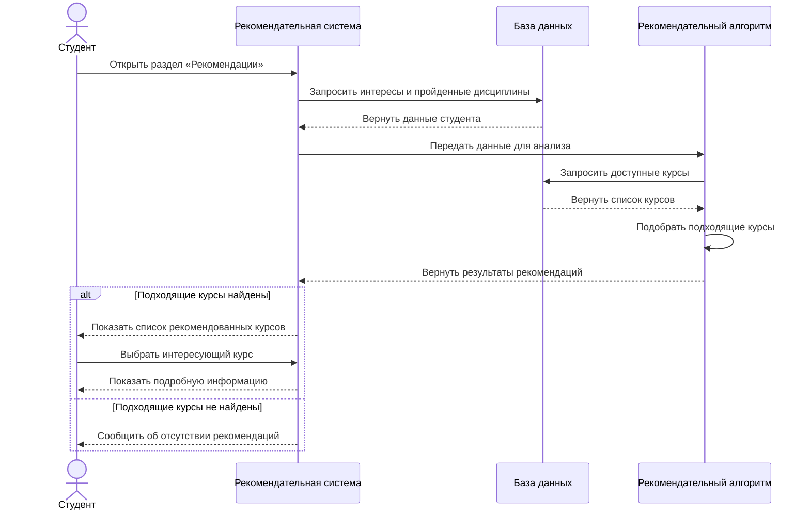
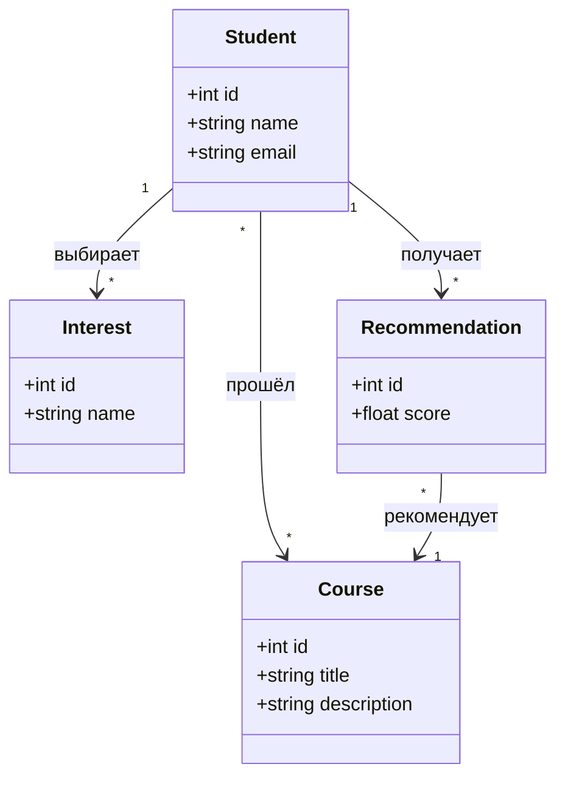

# Диаграммы

## Диаграмма последовательности

Диаграмма последовательности описывает процесс получения студентом персональных рекомендаций учебных курсов на основе его интересов и ранее пройденных дисциплин.

## Диаграмма классов

Диаграмма классов описывает основные сущности рекомендательной системы учебных курсов, их атрибуты и связи между ними.
